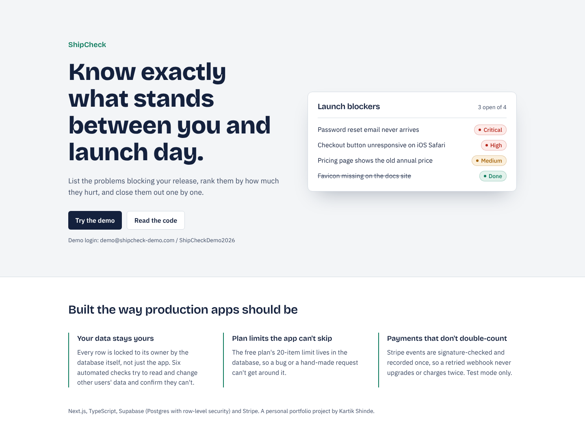

# ShipCheck

A small launch-blocker tracker for app teams. It is a **personal portfolio project** by Kartik Shinde, built to show a production-style Next.js + Supabase + Stripe setup end to end.

**Live demo:** https://shipcheck-kartik.vercel.app (demo login: `demo@shipcheck-demo.com` / `ShipCheckDemo2026`)

> Payments run in **Stripe test mode only**. No real money is involved.



## What it demonstrates

| Area | How it is done | Where |
| --- | --- | --- |
| Auth | Supabase email + password, session refreshed in the Next.js proxy, `/dashboard` protected | `src/proxy.ts`, `src/app/login` |
| Data isolation | Postgres Row Level Security: users can only read and change their own rows | `supabase/migrations/0001_init.sql` |
| Business rule in the database | Free plan limited to 20 issues by a trigger, so the UI cannot be bypassed | same migration |
| Payments | Stripe Checkout (subscription) tied to the user with `client_reference_id` | `src/app/api/checkout/route.ts` |
| Webhooks | Signature verified on the raw body; idempotent via a unique event-id table; plan changes mapped by a pure, tested function | `src/app/api/stripe/webhook/route.ts`, `src/lib/billing.ts` |
| Config safety | Environment validated at startup; live Stripe keys rejected | `src/lib/env.ts` |
| Server-only secrets | Service-role key used only inside the webhook, never in the browser | `src/lib/supabase/server.ts` |

## Tests

```bash
npm test          # 14 unit tests: validation, sorting, billing mapping, webhook signatures, env checks
npm run test:db   # 6 database security checks against real PostgreSQL (needs local psql access)
npm run test:e2e  # 3 browser tests x desktop + mobile: landing, route protection, sign up -> add -> close a blocker
npm run type-check && npm run lint && npm run build
```

The database checks prove that a user cannot insert rows for someone else, cannot read, update or delete other users' rows, is stopped at 20 issues on the free plan, is not stopped on Pro, and cannot read the Stripe event log.

## Run locally

1. Create a Supabase project and run `supabase/migrations/0001_init.sql` in its SQL editor.
2. Copy `.env.example` to `.env.local` and fill in the values (Stripe test keys only).
3. `npm install --legacy-peer-deps && npm run dev`
4. For webhooks locally: `stripe listen --forward-to localhost:3000/api/stripe/webhook`

## Stack

Next.js 16 (App Router, server actions), React 19, TypeScript, Tailwind CSS, Supabase (Postgres, Auth, RLS), Stripe, Zod, Vitest, Playwright.
